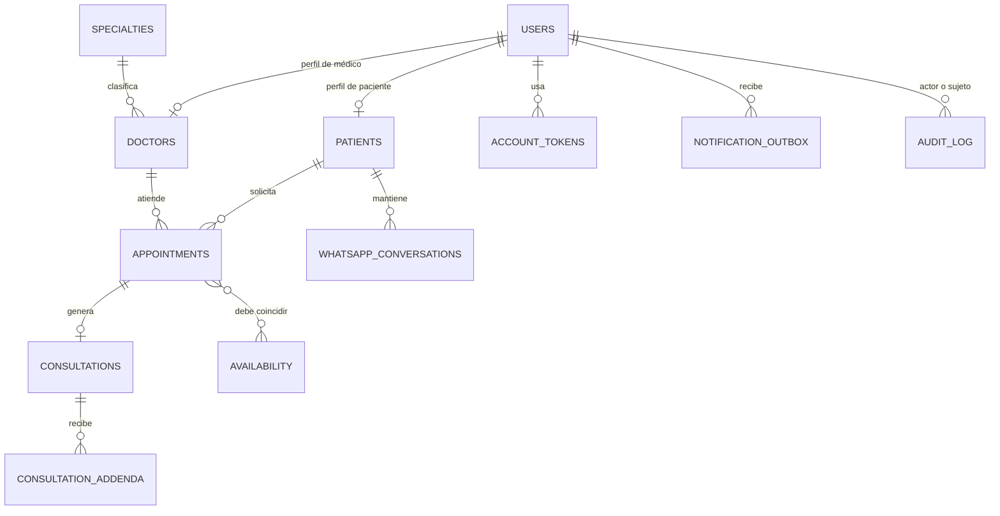

# Relaciones entre entidades

## Diagrama lógico provisional

El diagrama refleja exclusivamente relaciones citadas en el contexto maestro. Es lógico y provisional; no fija nombres de claves foráneas ni cardinalidades opcionales definitivas.

`AVAILABILITY` representa conceptualmente las cuatro tablas de bloques, detalle y excepciones. `AUDIT_LOG` es un nombre conceptual, no el nombre aprobado de la tabla. La relación de outbox con usuario y la relación de auditoría requieren confirmar si los registros admiten destinatarios/actores no vinculados.

## Reglas de relación

- Identificación personal se centraliza en `users`; `patients` y `doctors` contienen datos propios de cada rol.
- Un médico tiene una especialidad principal según alcance actual.
- Citas enlazan paciente, médico y disponibilidad aplicable.
- Una consulta pertenece a su cita y las aclaraciones no sustituyen el texto original.
- Los registros históricos deben sobrevivir a desactivaciones y cancelaciones.

## Confirmación pendiente

Validar el diagrama contra el diseño físico aprobado antes de definir asociaciones Sequelize, nulabilidad, cascadas o migraciones.

